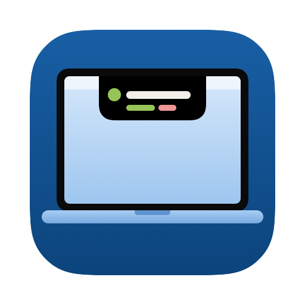
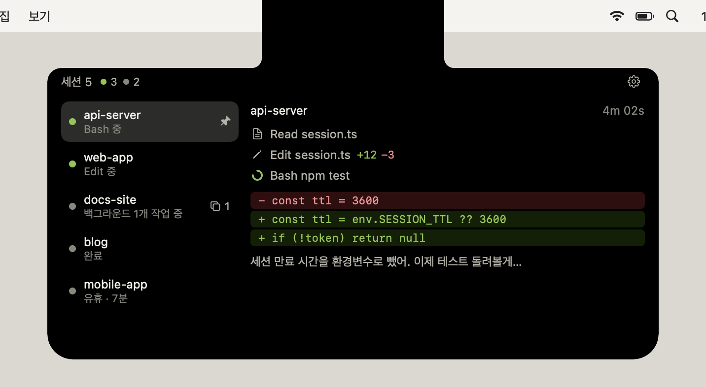
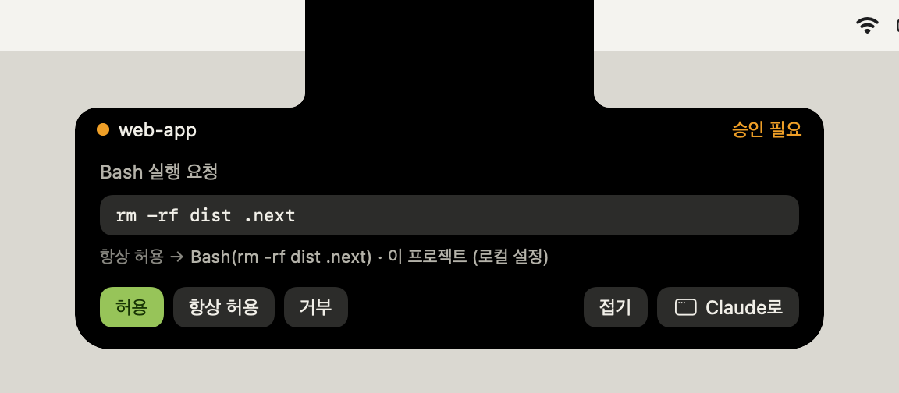

<div align="center">



# AgentNotch

**맥북 노치에서 Claude Code · Codex 세션이 지금 뭘 하는지 보여주는 메뉴바 앱**


[](https://github.com/ldg030201/agent-notch/releases)
[](LICENSE)




</div>

## 설치

```bash
brew tap ldg030201/agent-notch https://github.com/ldg030201/agent-notch && brew trust ldg030201/agent-notch && brew install -y agent-notch && cp -R "$(brew --prefix agent-notch)/AgentNotch.app" /Applications/ && open /Applications/AgentNotch.app
```

Apple Silicon(M1 이상) 맥, macOS 14 이상, Homebrew만 있으면 돼요. Xcode는 필요 없어요.

처음 실행하면 훅 설치(Claude Code · Codex)와 로그인할 때 자동으로 켜기를 한 번에 물어봐요.
Codex 는 새 훅을 한 번 검토해야 실행해요 (Codex 앱의 훅 검토, CLI 는 `/hooks`).

## 업데이트

새 버전이 나오면 설정 → **버전** 탭에서 **업데이트** 를 누르세요. 받은 뒤 **지금 다시 띄우기** 를 누르면 새 버전으로 바뀌어요.

터미널에서 하려면:

```bash
git -C "$(brew --repository ldg030201/agent-notch)" pull -q || brew update
brew upgrade agent-notch
pkill -f /Applications/AgentNotch.app/Contents/MacOS/AgentNotch; sleep 1
rm -rf /Applications/AgentNotch.app && cp -R "$(brew --prefix agent-notch)/AgentNotch.app" /Applications/ && open /Applications/AgentNotch.app
```

`brew upgrade` 만 하면 `/Applications` 쪽은 옛 버전 그대로예요. 꼭 다시 복사해 주세요.

## 더 보기

- [사용 가이드](docs/usage.md): 기능과 화면, 단축키, 설정, 제거, 문제 해결, 개인정보
- [개발과 릴리스](docs/development.md) · [설계](docs/architecture.md)

## 아이콘 저작권 · 라이선스

세션 앞에 붙는 Clawd 와 Claude · Claude Code 이름은 **Anthropic**, Codex 아이콘과 Codex · OpenAI 이름은 **OpenAI** 의 저작물 · 상표예요.
어느 에이전트의 세션인지 구분하려고만 쓰고, MIT 라이선스에 포함되지 않아요 ([NOTICE](NOTICE)).
AgentNotch 는 Anthropic · OpenAI 와 관계없는 비공식 프로젝트예요. 권리자가 요청하면 바로 내릴게요.

코드는 [MIT](LICENSE).
