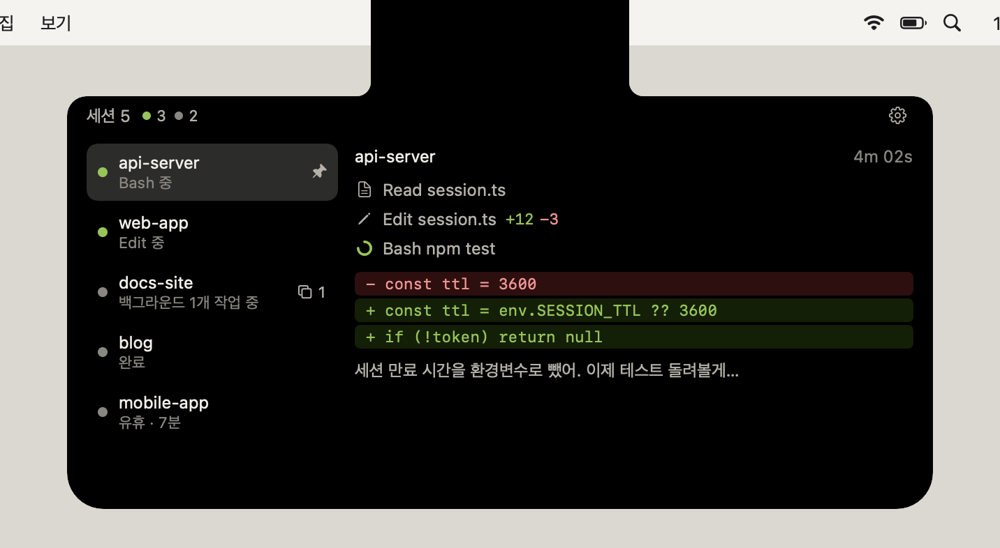
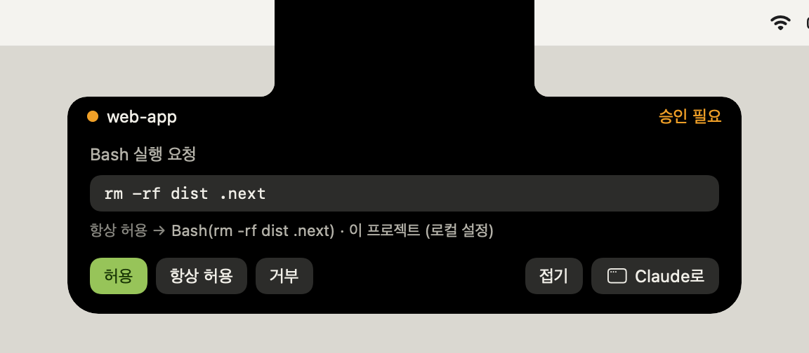
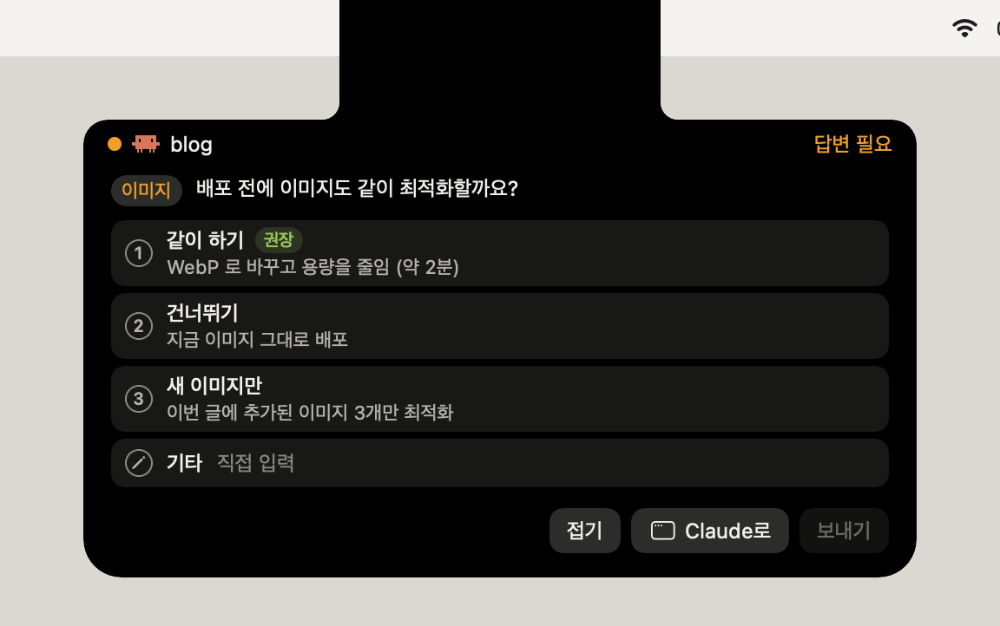
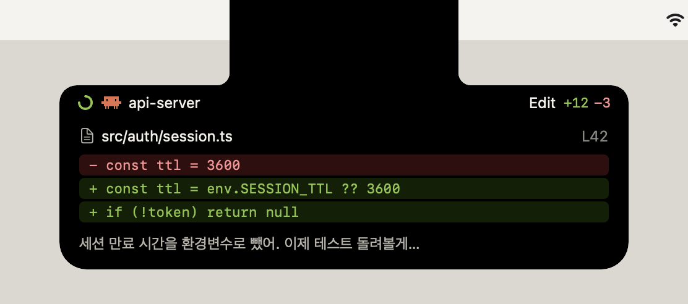
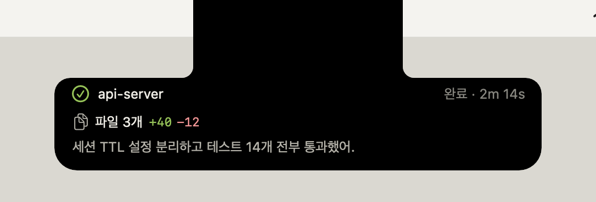
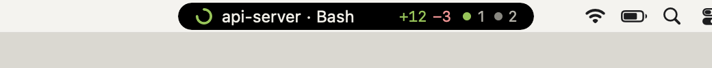

<div align="center">

# AgentNotch

**맥북 노치에서 Claude Code 세션이 지금 뭘 하는지 보여주는 메뉴바 앱**


[](https://github.com/ldg030201/agent-notch/releases)
[](LICENSE)

</div>

터미널이나 Claude 앱으로 돌아가지 않고 노치에서 바로 확인하고 처리해요.

<p align="center">
  
</p>

## 주요 기능

- **지금 하는 일**: 프로젝트와 쓰고 있는 툴, 바뀐 줄 수, 전체 세션 상태, 백그라운드 작업 수를 보여줘요.
- **여러 세션**: 일하는 세션을 몇 초마다 번갈아 보여주고, 알림이 온 세션은 바로 띄워요. 우클릭으로 고정할 수 있고, 펼친 목록은 진행 중인 세션이 위로 와요.
- **권한 요청과 질문**: 삭제 같은 권한 요청을 노치에서 바로 허용하거나 거부하고, Claude가 묻는 객관식 질문과 계획 승인에도 답해요. Claude 앱을 보고 있을 때도 돼요.
- **세션으로 바로 이동**: 카드의 "Claude로"를 누르면 Claude 앱에서 그 세션이 바로 열려요. 터미널 세션은 그 터미널로 가요.
- **파일 수정 미리보기**: 파일을 고치면 잠깐 펼쳐서 바뀐 줄을 보여줘요.
- **완료 알림**: 걸린 시간과 바뀐 파일, 마지막 응답 한 줄을 보여줘요.
- **외부 모니터**: 노치가 없는 화면에서는 메뉴바 안의 알약으로 같은 내용을 보여줘요.
- **개인정보**: 세션 내용은 내 맥 밖으로 나가지 않아요. 네트워크 통신은 하루 한 번 새 버전 확인뿐이에요.

## 화면

| 권한 요청 (노치에서 바로 승인) | 질문 (Claude 앱 세션도 노치에서 고르기) |
|:-:|:-:|
|  |  |
| **파일 수정 미리보기** | **완료** |
|  |  |
| **작업 중 (노치 아래 띠)** | **외부 모니터 (메뉴바 안 알약)** |
|  |  |

스크린샷은 가짜 데이터로 실제 화면을 그린 거예요 (`scripts/readme-images.sh`).

## 설치

```bash
brew tap ldg030201/agent-notch https://github.com/ldg030201/agent-notch && brew trust ldg030201/agent-notch && brew install -y agent-notch && cp -R "$(brew --prefix agent-notch)/AgentNotch.app" /Applications/ && open /Applications/AgentNotch.app
```

Apple Silicon(M1 이상) 맥, macOS 14 이상, Homebrew만 있으면 돼요. Xcode는 필요 없어요. Intel 맥은 지원하지 않아요.
애플 개발자 서명과 공증을 받지 못해서 cask 대신 formula로 배포해요. 그래서 Gatekeeper에 막히지 않아요.

## 시작하기

1. 앱을 처음 실행하면 Claude Code 훅 설치와 로그인할 때 자동으로 켜기를 한 번에 물어봐요. 훅은 `~/.claude/settings.json`을 백업한 뒤 AgentNotch 항목만 추가해요.
2. 새로 시작하는 Claude Code 세션부터 노치에 나타나요. 훅 없이 먼저 보려면 메뉴바 아이콘을 누르고 **데모 재생**을 고르세요.

업데이트는 설정의 **버전** 탭에서 버튼 하나로 해요.

## 더 보기

- [사용 가이드](docs/usage.md): 화면, 단축키, 설정, 외부 모니터, 업데이트, 제거, 문제 해결, 개인정보
- [개발과 릴리스](docs/development.md)
- [설계](docs/architecture.md)

## 라이선스

[MIT](LICENSE)
